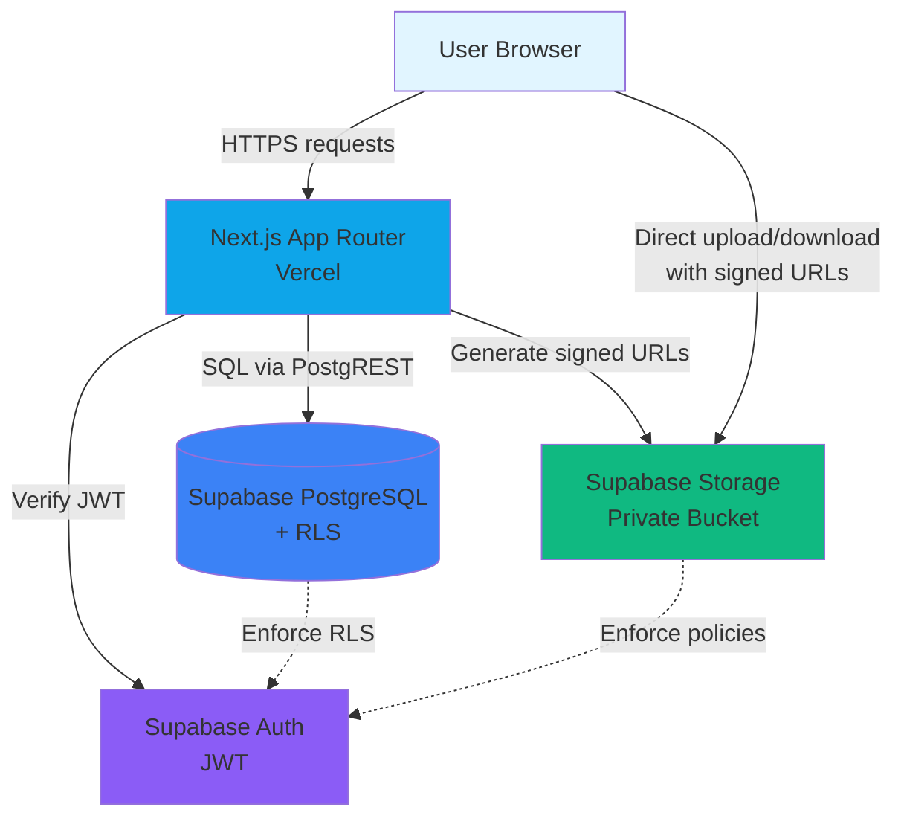
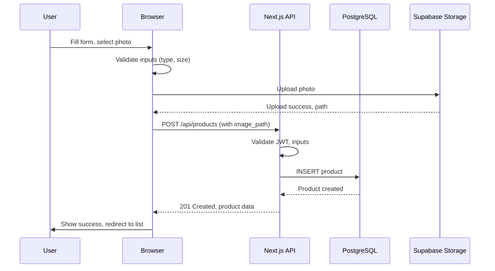
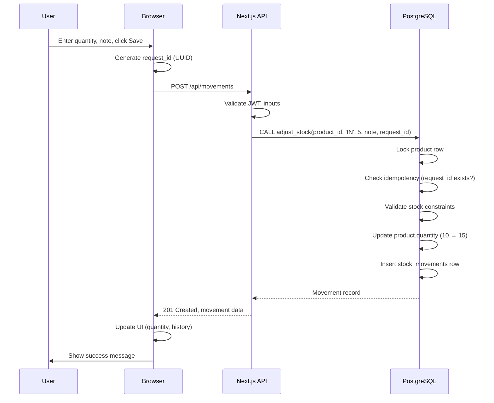
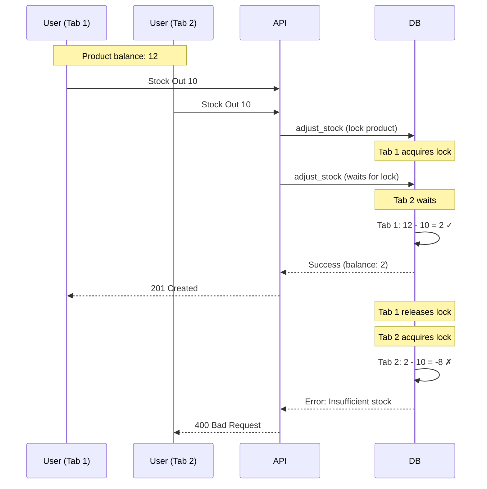

# StockLite — Architecture Overview

This document describes the architecture, data flow, and integration points of StockLite — Inventory Tracker.

---

## System Architecture



---

## Technology Stack

| Layer | Technology | Purpose |
|-------|------------|---------|
| **Frontend** | React 18, Next.js 14 App Router | UI components, routing, client-side state |
| **Styling** | Tailwind CSS | Utility-first styling, responsive design |
| **Type Safety** | TypeScript | Static typing, compile-time checks |
| **Backend** | Next.js Route Handlers (App Router) | API endpoints, server-side logic |
| **Database** | Supabase PostgreSQL | Relational data storage, transactions |
| **Auth** | Supabase Auth | Email/password authentication, session management |
| **Storage** | Supabase Storage | Object storage for product photos |
| **Security** | Row-Level Security (RLS) | Data isolation per user |
| **Deployment** | Vercel | Hosting, CI/CD, serverless functions |

---

## Application Layers

### 1. Presentation Layer (Frontend)

**Location**: `app/` directory

**Components**:
- **Pages**: Dashboard, product list, product details, forms
- **Client Components**: Interactive forms, modals, real-time updates
- **Server Components**: Data fetching, static rendering where possible

**Key Patterns**:
- **Server Components by default**: Reduces JavaScript bundle size
- **Client Components for interactivity**: Forms, modals, state management
- **Progressive enhancement**: Works without JavaScript for basic navigation
- **Responsive design**: Mobile-first, adapts to tablet and desktop

**State Management**:
- URL state for filters and navigation (search params)
- React state for forms and UI interactions
- No global state library needed (scope is limited)

---

### 2. API Layer (Backend)

**Location**: `app/api/` directory

**Route Handlers**:
- `GET /api/products` — List products with filters
- `GET /api/products/[id]` — Fetch single product
- `POST /api/products` — Create product
- `PATCH /api/products/[id]` — Update product
- `DELETE /api/products/[id]` — Delete product (if no movements)
- `POST /api/products/[id]/archive` — Archive product
- `POST /api/products/[id]/restore` — Restore product
- `GET /api/products/[id]/movements` — Movement history
- `POST /api/movements` — Create stock movement (atomic)
- `GET /api/dashboard` — Summary statistics

**Responsibilities**:
- Authenticate requests (verify Supabase JWT)
- Validate input (schema, business rules)
- Call database functions for atomic operations
- Return structured JSON responses
- Log operations with request IDs

**Security**:
- All routes require authentication
- RLS enforces ownership at database level
- Input validation on both client and server
- Idempotency keys prevent duplicate movements

---

### 3. Database Layer

**Location**: `supabase/migrations/`

**Tables**:

#### `products`
- `id` (UUID, primary key)
- `owner_id` (UUID, foreign key to auth.users)
- `sku` (text, unique per owner, uppercase)
- `name` (text, non-empty)
- `category` (text, non-empty)
- `unit_price` (numeric, >= 0)
- `quantity` (integer, >= 0)
- `low_stock_threshold` (integer, >= 0)
- `image_path` (text, nullable, storage reference)
- `archived_at` (timestamp, nullable)
- `created_at` (timestamp)
- `updated_at` (timestamp)

**Constraints**:
- Unique: `(owner_id, sku)`
- Check: `quantity >= 0`, `unit_price >= 0`, `low_stock_threshold >= 0`

#### `stock_movements`
- `id` (UUID, primary key)
- `product_id` (UUID, foreign key to products, cascade delete)
- `owner_id` (UUID, foreign key to auth.users)
- `type` (text, `'IN'` or `'OUT'`)
- `quantity` (integer, > 0)
- `previous_balance` (integer, >= 0)
- `resulting_balance` (integer, >= 0)
- `note` (text, nullable)
- `request_id` (UUID, unique, client-provided idempotency key)
- `created_at` (timestamp)

**Constraints**:
- Check: `quantity > 0`, `previous_balance >= 0`, `resulting_balance >= 0`
- Unique: `request_id`

**Indexes**:
- `products(owner_id)` — Fast user-scoped queries
- `products(owner_id, archived_at)` — Filter active/archived
- `stock_movements(product_id, created_at DESC)` — Movement history
- `stock_movements(request_id)` — Idempotency lookups

**Database Functions**:

#### `adjust_stock(p_product_id UUID, p_type TEXT, p_quantity INT, p_note TEXT, p_request_id UUID)`

**Purpose**: Atomically update product quantity and insert movement record.

**Logic**:
1. Lock the product row (`FOR UPDATE`)
2. Check if `request_id` already exists (idempotency)
   - If exists, return existing movement
3. Validate:
   - Product exists and not archived
   - For `OUT`: `quantity <= current_balance`
4. Calculate new balance:
   - `IN`: `new_balance = current + quantity`
   - `OUT`: `new_balance = current - quantity`
5. Update `products.quantity`
6. Insert `stock_movements` row with previous and resulting balances
7. Return movement record

**Why a function?**
- Ensures atomicity: both updates succeed or both fail
- Serializes concurrent updates (locking prevents lost updates)
- Enforces business rules at database level (client cannot bypass)
- Idempotency: retrying with same `request_id` is safe

---

### 4. Authentication

**Provider**: Supabase Auth

**Flow**:
1. User submits email/password to Supabase Auth API
2. Supabase returns JWT access token and refresh token
3. Client stores tokens (secure HTTP-only cookies managed by `@supabase/ssr`)
4. Every API request includes JWT in Authorization header or cookies
5. Backend validates JWT with Supabase
6. `auth.uid()` used in RLS policies to scope data

**Session Management**:
- Access tokens expire after 1 hour (configurable)
- Refresh tokens last 30 days
- Client automatically refreshes tokens
- Sign-out clears tokens

**Security**:
- Passwords hashed with bcrypt
- JWTs signed by Supabase secret key
- Rate limiting on auth endpoints (Supabase default)

---

### 5. Storage

**Provider**: Supabase Storage

**Bucket**: `product-photos` (private)

**Path Structure**: `{owner_id}/{uuid}.{ext}`

**Upload Flow**:
1. User selects photo in product form
2. Client validates file type (JPEG, PNG, WebP) and size (< 2 MB)
3. Generate unique filename: `crypto.randomUUID() + extension`
4. Call `supabase.storage.from('product-photos').upload(path, file)`
5. On success, save `path` to `products.image_path`
6. On failure, display error and offer retry or save-without-photo

**Access Control**:
- Bucket policies check `(storage.foldername(name))[1] = auth.uid()::text`
- Users can only upload/read/delete files in their own folder
- Display uses signed URLs (temporary, secure access)

**Signed URLs**:
- Generated server-side by `GET /api/products` (`createSignedUrl(path, 300)`)
- Expire after 5 minutes; Refresh inventory requests new ones
- Allow temporary access without exposing storage credentials

---

## Data Flow Examples

### Example 1: Add Product with Photo



**Edge case: Upload succeeds, product save fails**:
- Browser displays error
- Offers retry (reuses uploaded photo path) or save-without-photo
- Cleanup of orphaned photo is manual or scheduled job

---

### Example 2: Stock In Movement



**Idempotent retry**:
- User clicks Save again (network timeout, uncertain outcome)
- Same `request_id` sent
- Database finds existing movement with that `request_id`
- Returns existing movement without creating duplicate
- Balance remains correct

---

### Example 3: Concurrent Stock Out (Race Condition)



**Result**: Serialized updates prevent negative stock or lost updates.

---

## Security Architecture

### Row-Level Security (RLS)

**Principle**: Users can only access their own data.

**Implementation**:
- RLS enabled on `products` and `stock_movements`
- Policies filter rows where `owner_id = auth.uid()`
- Enforced at database level (cannot be bypassed by client)

**Example Policy** (`products` SELECT):
```sql
CREATE POLICY "Users can view own products"
ON products FOR SELECT
TO authenticated
USING (owner_id = auth.uid());
```

**Benefits**:
- Defense in depth: Even if API validation is bypassed, database blocks unauthorized access
- Automatic: No manual filtering needed in queries
- Auditable: Policies are versioned and reviewable

---

### Storage Policies

**Principle**: Users can only upload/read/delete files in their own folder.

**Path enforcement**:
- Upload path must start with `{user_id}/`
- Storage policy checks `(storage.foldername(name))[1] = auth.uid()::text`

**Private bucket + signed URLs**:
- Files not publicly accessible
- Signed URLs generated per request
- Temporary access (expire after configured time)

---

### Input Validation

**Client-side** (UX):
- Immediate feedback
- Type, required, min/max checks
- File size and type validation

**Server-side** (Security):
- All validations repeated
- Schema validation (Zod or manual)
- Business rule checks (e.g., duplicate SKU, insufficient stock)
- Never trust client input

---

## Scalability Considerations

**Current design supports**:
- Small to medium inventories (< 10,000 products per user)
- Moderate traffic (< 1,000 requests/minute)
- Multiple concurrent users (hundreds)

**Bottlenecks**:
- Database connection pool (Supabase free tier: limited connections)
- Storage bandwidth (Supabase free tier: 2 GB/month)
- Vercel serverless function cold starts

**Optimization strategies**:
- Database indexes on common queries
- Caching (Next.js built-in for static pages)
- CDN for static assets (Vercel default)
- Connection pooling (Supabase auto-managed)
- Upgrade Supabase/Vercel tiers for higher limits

---

## Deployment Architecture

**Local Development**:
```
Developer Machine
  ├── Next.js Dev Server (localhost:3000)
  ├── .env.local (dev Supabase credentials)
  └── Hot reload, debug logs
```

**Production (Vercel + Supabase)**:
```
User → Vercel Edge Network (CDN)
     → Vercel Serverless Functions (Next.js)
     → Supabase (PostgreSQL, Auth, Storage)
```

**Edge Deployment**:
- Static assets served from global CDN
- API routes run in serverless functions (regional)
- Database queries go to Supabase region (configured in project)

**Environment Separation**:
- Development: Local, dev Supabase project
- Staging: Vercel preview deployments, staging Supabase project
- Production: Vercel production deployment, production Supabase project

---

## Error Handling Strategy

**Client**:
- Display user-friendly messages
- Offer retry for transient failures
- Log errors to console (dev mode only)

**Server**:
- Catch all exceptions
- Return structured error responses (JSON)
- Log errors with request IDs
- Never expose sensitive details (stack traces, DB errors) to client

**Database**:
- Constraints enforce data integrity
- Functions return error codes for business rule violations
- Transactions roll back on failure

**Storage**:
- Validate before upload
- Handle quota exceeded, network timeouts
- Cleanup orphaned files (manual or scheduled)

---

## Monitoring and Observability

**Logging**:
- Server logs: Request IDs, operation names, outcomes
- Client logs: Errors (dev mode only)
- Database logs: Query performance, slow queries (Supabase dashboard)

**Metrics** (if enabled):
- Vercel Analytics: Page views, performance
- Supabase Dashboard: Connection pool usage, storage quota

**Alerting** (production):
- Vercel: Build failures, deployment errors
- Supabase: Database paused, quota exceeded

---

## Future Enhancements (Out of Scope)

- **Multi-user workspaces**: Shared inventories with roles (owner, editor, viewer)
- **Advanced reporting**: Stock value, movement trends, category breakdowns
- **Barcode scanning**: Mobile app integration
- **CSV import/export**: Bulk operations
- **Audit logs**: Who changed what and when (beyond movement history)
- **Notifications**: Low-stock alerts, email reports
- **API rate limiting**: Explicit middleware (currently relying on Supabase defaults)

---

## Summary

StockLite is a full-stack Next.js application with:
- **Frontend**: React Server Components + Client Components
- **Backend**: Next.js Route Handlers
- **Database**: Supabase PostgreSQL with RLS
- **Auth**: Supabase Auth (email/password, JWT)
- **Storage**: Supabase Storage (private bucket, signed URLs)
- **Deployment**: Vercel (serverless, CDN)

**Key design decisions**:
- Server Components first (performance)
- Database functions for atomic operations (correctness)
- RLS for security (defense in depth)
- Idempotency keys (reliability)
- Private storage with signed URLs (security)

**Trade-offs**:
- Single-user inventories (simplicity over multi-tenant complexity)
- Email/password only (simplicity over OAuth providers)
- Manual photo cleanup (simplicity over automatic garbage collection)
- No real-time updates (simplicity over WebSocket complexity)

---

## Related Documentation

- `docs/database-schema.md` — Detailed table structures and constraints
- `docs/api-reference.md` — Complete API endpoint specifications
- `docs/deployment.md` — Production deployment instructions
- `docs/debugging-guide.md` — Troubleshooting and diagnostic procedures
- `teaching/` — Session guides, exercises, and test materials
