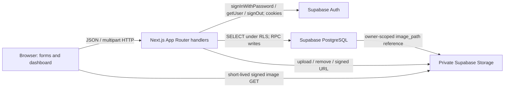

# Architecture and interaction traces

The browser has no privileged SDK key. Next.js uses the public publishable key plus the caller's cookie-backed session. Route Handlers call `getUser()` against Auth before any inventory work. All protected reads and writes occur in handlers, so no Server Component needs token refresh and no proxy is necessary for this application. The SSR cookie adapter writes refreshed cookies in Route Handlers. Responses containing user data are `no-store`; do not add CDN caching. Auth sessions are never trusted just because a cookie exists.

1. Product form → browser required/min/step constraints → POST/PUT `/api/products` → Zod checks → `save_product` → constraints and ownership → refreshed list/dashboard. On failed refresh after a successful mutation, inspect the saved SKU before creating again.
2. File selection → browser type/size feedback → multipart POST `/api/photos` → server size/MIME/signature checks → Supabase upload with generated owner path → `{path}` → save product reference → product list signs the path for 300 seconds → image displayed. These are separate operations, not a distributed transaction.
3. Stock-out form → POST `/api/movements` with UUID → validation → `adjust_stock` advisory key lock + product row lock → balance update and history insert in one transaction → refreshed history and dashboard. A stale browser preview is only a preview; PostgreSQL decides whether stock exists.

Observe each boundary in Network. React components: Home owns collection/filter/detail state; ProductForm coordinates storage and product save; MovementForm retains the retry key; History renders records. This intentionally compact structure favors tracing over framework abstraction. Production hardening beyond class scale would include pagination, distributed rate limiting, orphan-photo maintenance and richer observability.
